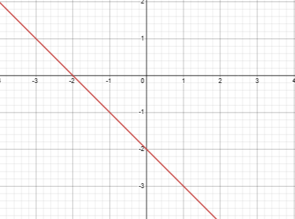

# Perzeptron Blatt

# Aufgabe 1
## Graph zeichnen
Der Graph der gezeichnet wird ist y=-x-2. Da wir das w= 2,1,1 haben
kommen wir auf: 

0 = w_0 + w_1 x_1 + w_2 x_2

Also:
0 = 2+x+x_2 und dies setzen wir nach x_2 um

x_2 = -x-2 was dann auch y=-x-2 ist.

Graph wurde mit desmos erstellt.

## Trennebene und Klassifikation

    $(w_0,w_1,w_2)^T = (1, 0.5, 0.5)^T$
    Genau gleich

    $(w_0,w_1,w_2)^T = (200, 100, 100)^T$
    Genau gleich

    $(w_0,w_1,w_2)^T = (\sqrt{2}, \sqrt{1}, \sqrt{1})^T$
    Nicht die selbe Grenze, aber gleiche Klassifikation

    $(w_0,w_1,w_2)^T = (-2, -1, -1)^T$
    Selbe Grenze, aber NICHT die selbe Klassifikation

# Aufgabe 2
### UND:
Gewichtsvektor: (w=(-1.5,1,1)^T)

[z=-1.5+x_1+x_2]

Nur wenn beide Eingaben 1 sind, ist die Ausgabe +1.

### ODER:

Gewichtsvektor: (w=(-0.5,1,1)^T)

[z=-0.5+x_1+x_2]

Die Ausgabe ist +1, sobald mindestens eine Eingabe 1 ist.

### KOMPLEMENT (NOT):

Gewichtsvektor: (w=(0.5,-1)^T)

[z=0.5-x_1]

Die Ausgabe wird umgekehrt: 0 ergibt +1 und 1 ergibt -1.

## Warum geht XOR nicht?

Ein einzelnes Perzeptron kann nur eine Gerade erstellen. Bei XOR liegen die positiven und negativen Punkte diagonal gegenüber. Sie können daher nicht durch eine einzige Gerade getrennt werden.

# Aufgabe 3

### Auswertung Aufgabe 3

Hier ist aufgefallen, dass das Perzeptron mit mehr Datenpunkten auch mehr Schritte zum Lernen benötigt. Bei 10 Punkten waren es durchschnittlich nur 7,9 Schritte. Bei 100 Punkten waren es ungefähr 160 und bei 1000 Punkten etwa 630 Schritte.

Die beiden Lernraten haben dabei kaum einen Unterschied gemacht. Man sieht aber, dass die Anzahl steigt je höher das m ist.

bsp. Ausgabe:

Durchschnittliche Schritte: 7.9

m=100, alpha=1: 161.05 Schritte

m=100, alpha=0.1: 157.42 Schritte

m=1000, alpha=1: 638.15 Schritte

m=1000, alpha=0.1: 627.21 Schritte
